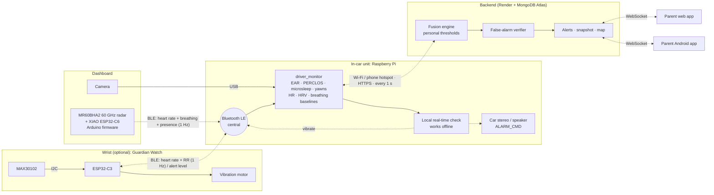
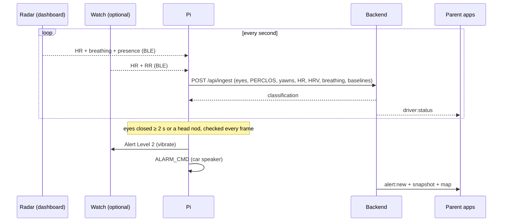

# Vital signs: dashboard radar, Bluetooth watch, real-time fatigue fusion

Guardian Drive combines **what the camera sees** (eye closure, PERCLOS, microsleeps, yawning,
head nodding) with
**what the body does** (heart rate, breathing, heart-rate variability). It evaluates them in real time
against each driver's own thresholds. Nothing is wired to the driver, and every link in the car is
**wireless**:

- a **60 GHz radar on the dashboard** measures heart rate and breathing without contact (Bluetooth LE → Pi),
- an **optional wrist watch** adds beat-to-beat heart data and **vibrates** to wake the driver (Bluetooth LE ↔ Pi),
- the **Raspberry Pi** runs the camera analysis and sends everything to the cloud over Wi-Fi.

## 1. Recommended build (best value)

| Part | Role | Approx. price* | Needed? |
|---|---|---|---|
| Raspberry Pi 4 (4 GB) or Pi 5 + power + 32 GB card | In-car hub: camera analysis, Bluetooth, uplink | US$60–90 | ✅ |
| USB webcam 720p (or Pi Camera Module 3) | Eyes, yawns, head pose, snapshot | US$10–25 | ✅ |
| **Seeed Studio MR60BHA2 60 GHz mmWave kit** (radar + XIAO ESP32-C6) | **Dashboard: contactless heart rate + breathing + presence** | **US$35–45** | ✅ **recommended** |
| Guardian Watch: XIAO ESP32-C3 + MAX30102 + coin motor + LiPo | Vibration alert on the wrist, beat-to-beat HR (HRV) | US$12–20 | optional |
| Bluetooth speaker / the car's Bluetooth stereo | Audible alarm (`ALARM_CMD`) | US$0–15 | optional |

*Rough hobby-store prices for orientation. Check current prices locally.

Cheapest complete system: **Pi + webcam + radar kit**. It has no wearable and is fully contactless.
Wake-up alerts then come from the car's speaker (`ALARM_CMD`). Add the watch when you want a vibration
the driver feels even with loud music, or HRV data for your evaluation.

### Why this combination

| Option | Verdict |
|---|---|
| **Pi + dashboard mmWave radar (+ optional watch)** | ✅ Contactless, embedded in the dashboard, two body signals (heart + breathing), cheap, Arduino-programmable, no wires to the driver |
| Pi + an Arduino wired to it | ❌ Adds a board and cables but no capability; the Pi already has Bluetooth LE |
| Arduino only | ❌ Cannot run face landmarks at 10 frames per second |
| Camera-only heart rate (rPPG) | ❌ Unreliable with car vibration and changing light |
| TI IWR6843 / AWR6843 radar | Better accuracy (automotive-grade), but several times the price and needs the TI SDK and your own signal processing |
| Steering-wheel ECG (AD8232) | Best heart data, but only with both hands on the wheel and it needs wiring in the wheel |

**The radar (MR60BHA2):** a 60 GHz sensor that measures the tiny chest movements of breathing and
heartbeat at 0.5–1.5 m, through plastic. Seeed sells it as a kit with a XIAO ESP32-C6 (Wi-Fi + BLE),
so it needs only USB power. Our firmware makes it look like a **standard Bluetooth heart-rate sensor**,
plus a breathing-rate characteristic.

**The watch:** the MAX30102 must sit on the skin, so it needs its own small battery board on the
wrist. An ESP32-C3 programmed in the Arduino IDE is that board. It uses the same standard
heart-rate profile, so a commercial strap (Polar, Coospo, Garmin HR broadcast) can replace it for
testing, minus the vibration.

## 2. System diagram



Dotted arrows are wireless. The only cables are the camera's USB and power cables. The radar's
and watch's internal wiring stays inside each device.

## 3. Hardware details

### 3.1 Dashboard radar

- **Board:** the Seeed MR60BHA2 kit. Nothing to solder; the radar and ESP32-C6 come assembled.
- **Mounting:**
  - On the dashboard or steering column, **facing the driver's chest**, 0.6–1 m away.
  - Not hidden behind the steering-wheel rim, a metal trim, or a metallised windshield tint (60 GHz doesn't pass metal).
  - Thin plastic covers are fine.
- **Power:** any USB port or USB car charger.
- **Seat gate:** set `MAX_DRIVER_DISTANCE_CM` in `wearable/guardian_radar/config.h` to your measured dashboard-to-chest distance + ~20 cm. People farther away (back seat) are ignored.
- **Status LED:**
  - **green**: streaming to the Pi
  - **blue**: waiting for the Pi
  - **red**: no driver in range

### 3.2 Watch (optional): bill of materials and wiring

| Part | Notes |
|---|---|
| Seeed Studio XIAO ESP32-C3 | BLE 5, LiPo charger on board |
| MAX30102 module (3.3 V) | On the inside of the strap, against the skin |
| Coin vibration motor 3 V + AO3400 MOSFET + 1N4148 + 100 kΩ | Haptic alert |
| Push button | Driver dismisses a vibration |
| LiPo 3.7 V 150–300 mAh, 2 × 220 kΩ (battery sense) | ~1–2 days per charge |

| From | To |
|---|---|
| MAX30102 VIN / GND / SDA / SCL | XIAO 3V3 / GND / **D4** / **D5** |
| Motor + / − | 3V3 / AO3400 drain (1N4148 across the motor, cathode to +) |
| AO3400 source / gate | GND / XIAO **D2** with 100 kΩ gate→GND |
| Button | XIAO **D1** ↔ GND |
| LiPo | XIAO BAT+ / BAT− |
| BAT+ → 220 kΩ → **A0** → 220 kΩ → GND | battery level (optional) |

Pins: [`wearable/guardian_watch/config.h`](../wearable/guardian_watch/config.h).

## 4. Bluetooth LE profiles (devices = peripherals, Pi = central)

| Device | Service | Characteristic | Content |
|---|---|---|---|
| Radar + watch | Heart Rate **0x180D** | Heart Rate Measurement **0x2A37**, notify 1 Hz | standard: flags · bpm · RR intervals (watch only). Contact bit = skin contact (watch) / driver in range (radar) |
| Radar | Guardian Vitals `6e0f0001-…0a01` | Vitals `6e0f0002-8c3b-4b8e-9a6e-6a5f3c1d0a01`, notify 1 Hz | uint16 breaths/min ×10 · uint16 distance cm · uint8 flags (bit0 present) |
| Watch | Battery **0x180F** | Battery Level **0x2A19** | 0–100 % |
| Watch | Immediate Alert **0x1802** | Alert Level **0x2A06**, write | `0` stop · `1` mild · `2` high vibration |

Names: radar **`GuardianRadar`**, watch **`GuardianWatch`**. No pairing needed; the Pi reconnects
automatically. Watch safety rules:
- **Link lost:** it stops vibrating when the Bluetooth link drops.
- **Timeout:** it stops after 60 s without a fresh command.
- **Button:** pressing it silences that level for 20 s.

## 5. What is measured

| Signal | Source | How |
|---|---|---|
| EAR, PERCLOS | camera | eye landmarks ~10×/s; PERCLOS = % of 30 s with eyes closed (relative to the driver's open-eye baseline) |
| **Microsleep** | camera | eyes **continuously** closed ≥ `drowsyDurationMs` (default 2 s) |
| **Yawns** | camera | mouth aspect ratio ≥ 0.5 held ≥ 1.5 s = one yawn; count over 5 min. Talking/laughing not counted |
| **Head nods** | camera | head pitch falls ≥ 15° below the driver's own neutral angle **fast** (≥ 25°/s), then either the eyes close or the head jerks back up (≥ 40°/s); count over 5 min. Slowly looking down at the console or a phone is not counted (see §5.1) |
| **Heart rate** | radar (primary) or watch | radar: median of the last 5 readings; watch: average of the last 6 beats. `HR_PRIORITY` picks which wins when both report |
| **HRV** (RMSSD) | watch only | beat-to-beat intervals over 60 s, artefacts removed (the radar gives a rate, not individual beats) |
| **Breathing rate** | radar | median of the last 5 readings, 4–40 breaths/min |
| **Personal baselines** | Pi | median HR, HRV and breathing over the first 3 min of the trip (driver fresh). Re-learned after 10 min without readings |

### 5.1 How a nod is told apart from looking down

| Head movement | Fall speed | Then | Counted? |
|---|---|---|---|
| Nodding off, startled awake | fast (> 25°/s) | jerk back up (> 40°/s) | ✅ nod |
| Nodding off, falls asleep | fast | eyes close while the head is down | ✅ nod (and the microsleep alarm fires too) |
| Glance at the phone | fast | calm return, eyes open | ❌ |
| Looking down at the console / radio | slow (< 25°/s) | any | ❌ |
| Face turned away / out of view | — | — | ❌ (no guess from missing data) |

"Neutral" is the median head angle over the last 30 s, so it adapts to each driver's posture and to
how high or low the camera is mounted. A counted nod immediately triggers the in-car alarm (watch
vibration and `ALARM_CMD`), with or without internet. Tunable in `.env`: `NOD_DEG`, `NOD_SPEED`.

Physiology: as drowsiness sets in, **heart rate and breathing slow down and HRV rises**,
relative to the same person awake. Comparing against each driver's own baseline catches a driver
whose awake HR is 85, and doesn't flag an athlete resting at 52.

## 6. Fusion (backend, every reading, per driver)

Per-driver thresholds (web/APK → driver page → Personal thresholds):

| Threshold | Default | Meaning |
|---|---|---|
| `earThreshold` | 0.21 | EAR below this = closing (auto-tuned daily) |
| `perclosThreshold` | 0.40 | PERCLOS that counts as fully drowsy |
| `drowsyDurationMs` | 2000 | continuous closure = microsleep (in-car alert) |
| `fusionWeightVision` / `fusionWeightPhysio` | 0.6 / 0.4 | eyes vs. body |
| `hrDropThreshold` | 0.15 | HR 15 % below baseline = full heart evidence |
| `breathDropThreshold` | 0.20 | breathing 20 % below baseline = full breathing evidence |
| `yawnThreshold` | 3 | yawns per 5 min = full yawn evidence; alone this raises a warning |
| `fusionWeightYawn` | 0.20 | extra weight of yawning |
| `nodThreshold` | 2 | head nods per 5 min that mean falling asleep → **drowsy** ("Head nodding" alert) |
| `fusionWeightNod` | 0.30 | extra weight of nodding (one nod = half of it) |

```
vision   = clamp((earThreshold − EAR) / earThreshold, 0, 1)
perclosS = clamp(PERCLOS / perclosThreshold, 0, 1)

physioAbs = HR < 60 ? clamp((60 − HR) / 15, 0, 1) : 0                       # any HR source
hrDrop    = clamp(((hrBase − HR) / hrBase) / hrDropThreshold, 0, 1)          weight 0.7
hrvRise   = clamp((HRV / hrvBase − 1) / 0.5, 0, 1)                           weight 0.3  (watch)
brDrop    = clamp(((brBase − BR) / brBase) / breathDropThreshold, 0, 1)      weight 0.4  (radar)
physio    = max(physioAbs, weighted mean of the parts that are available)

yawnS     = clamp(yawnCount / yawnThreshold, 0, 1)
nodS      = clamp(nodCount / nodThreshold, 0, 1)

score = clamp( wVision·(0.6·vision + 0.4·perclosS) + wPhysio·physio + wYawn·yawnS + wNod·nodS , 0, 1)
score > 0.70 → drowsy      score > 0.40 → warning      else alert
nodCount ≥ nodThreshold → drowsy  ("Head nodding" alert, red, 1-minute repeat)
alert but yawnCount ≥ yawnThreshold → warning ("Frequent yawning" alert)
```

- **Backward compatible:** without radar, watch, yawns or nods the formula equals the original one.
- **Verifier:** eye and body alerts still pass the false-alarm verifier (`ml/`). Yawning and nodding alerts are direct, debounced camera observations, so they skip it.
- **One nod tips the balance:** heavy eyelids alone (EAR 0.02, PERCLOS 50 %) score 0.57, a warning. Add one nod (+0.15) and it's 0.72, drowsy.
- **Python port:** `ml/guardian_ml/fusion.py` mirrors this exactly.

**Worked example** (radar + camera): EAR 0.16, PERCLOS 30 %, HR 64 vs. baseline 76 (−16 %),
breathing 13 vs. 16 (−19 %), 3 yawns:

| Term | Calculation | Contribution |
|---|---|---|
| Eyes | vision 0.24, perclos 0.75 → 0.6·(0.6·0.24 + 0.4·0.75) | 0.27 |
| Body | hrDrop 1.0, brDrop 0.94 → (0.7·1 + 0.4·0.94)/1.1 = 0.98 → 0.4·0.98 | 0.39 |
| Yawns | 0.2·1 | 0.20 |
| **Total** | | **0.86 → drowsy** |

The eyes alone (0.27) would not even be a warning. Body evidence alone tops out at 0.40, the warning
boundary, so the camera always has to agree before a "drowsy" verdict.

## 7. Real-time alert flow



| Path | Latency | Internet needed |
|---|---|---|
| Microsleep → vibration / speaker | `drowsyDurationMs` + ~0.1 s | No |
| Head nod → vibration / speaker | the moment the head jerks up or the eyes close (~0.1 s) | No |
| Backend verdict → vibration / speaker (warning = mild, drowsy = high) | ≤ 1 s + network | Yes |
| Backend unreachable > 5 s → local PERCLOS rule | per frame | No |
| Parent notification | ~1 s | Yes |

## 8. Setup

### 8.1 Arduino IDE (both devices)

1. *Preferences → Additional boards manager URLs*: `https://espressif.github.io/arduino-esp32/package_esp32_index.json` → *Boards Manager* → **esp32 by Espressif** 3.x (the C6 needs 3.x).
2. *Library Manager*: **NimBLE-Arduino** (h2zero, 2.x).
   - Radar also needs: **Seeed Arduino mmWave** (if it's not in the Library Manager, install the ZIP from github.com/Seeed-Projects/Seeed-mmWave-library) and **Adafruit NeoPixel**.
   - Watch also needs: **SparkFun MAX3010x Pulse and Proximity Sensor Library**.

### 8.2 Flash the radar

1. **Open the sketch:** `wearable/guardian_radar/guardian_radar.ino`. Set `MAX_DRIVER_DISTANCE_CM` in `config.h`.
2. **Upload:** board **XIAO_ESP32C6**, then Upload.
3. **Check the serial monitor** (115200 baud) while sitting in front of it. You should see `HR 72  breath 15.0  dist 80 cm  present 1`. Values settle after 10–30 s of sitting still.

### 8.3 Flash the watch (optional)

1. **Open the sketch:** `wearable/guardian_watch/guardian_watch.ino`, board **XIAO_ESP32C3**, then Upload.
2. **Check the serial monitor** while wearing it: `HR 72 bpm contact 1`. If contact stays `0`, lower `IR_CONTACT_THRESHOLD`.

Quick check for either device: the free **nRF Connect** phone app lists `GuardianRadar` / `GuardianWatch`; enable notifications on Heart Rate.

### 8.4 Pi configuration (`driver_monitor/.env`)

```
VITALS=ble                 # dashboard radar
VITALS_NAME=GuardianRadar
WEARABLE=ble               # watch (optional; leave off without one)
WEARABLE_NAME=GuardianWatch
HR_PRIORITY=radar          # or watch
WATCH_ALERTS=1
ALARM_CMD=paplay /home/pi/alarm.wav   # optional: alarm through a paired Bluetooth speaker / car stereo
```

Then run `sudo bash deploy/raspberry-pi/install.sh`. It installs BlueZ, turns Bluetooth on and restarts the service.

- **Log** (`journalctl -u guardian-drive-monitor -f`): look for `radar connected: GuardianRadar`, `watch connected: GuardianWatch`, then the `HR … / Breath …` lines.
- **Baselines:** they appear after 3 minutes.
- **Car audio:** pair the Pi once with the car stereo or a speaker: `bluetoothctl` → `scan on` → `pair <MAC>` → `trust <MAC>` → `connect <MAC>`.

### 8.5 What the parent sees

- **Driver cards** show EAR · PERCLOS · HR · **Yawns**, plus *Radar · 14.5 breaths/min* (or *driver not in range*) and *Watch connected · 81 %*.
- **Alerts** add **Frequent yawning** to the existing types.
- **Personal thresholds** add **Heart-rate drop**, **Breathing slow-down**, **Yawn limit** and **Yawn weight**.

## 9. Payload additions (developers)

All optional and additive; the frozen `/api/ingest` keys and response are unchanged.

```jsonc
{
  "signals": {
    "ear": 0.27, "perclos": 0.08, "heartRate": 71, "faceConfidence": 0.97, "matchedDriver": "…",
    "yawnCount": 1, "mar": 0.31, "nodCount": 0,
    "hrv": 42.5, "hrBaseline": 76.0, "hrvBaseline": 38.0,     // watch (RR intervals)
    "breathingRate": 14.5, "breathingBaseline": 16.0         // radar
  },
  "wearable": { "connected": true, "contact": true, "battery": 81, "name": "GuardianWatch" },
  "radar": { "connected": true, "present": true, "distanceCm": 82 }
}
```

| Path | What it does |
|---|---|
| `wearable/guardian_radar/` | MR60BHA2 + ESP32-C6 firmware: radar → BLE heart rate + vitals |
| `wearable/guardian_watch/` | ESP32-C3 + MAX30102 firmware: heart rate, battery, vibration |
| `driver_monitor/detectors/mouth.py` | yawn detector |
| `driver_monitor/detectors/head_nod.py` | head-nod detector (personal neutral pitch, fall/recovery speed) |
| `driver_monitor/sensors/heart_rate.py` | HRM + vitals parsers, RMSSD, HR/breathing baselines, source priority |
| `driver_monitor/sensors/ble_wearable.py` | BLE central for both devices (scan, subscribe, reconnect, vibrate) |
| `driver_monitor/fusion/watch_alerts.py` | in-car alert policy (microsleep, backend verdict, offline fallback) |
| `backend/src/services/fusionEngine.js` | fusion (Python twin: `ml/guardian_ml/fusion.py`) |

## 10. Limitations (read before relying on it)

- **Radar in a moving car:** mmWave vital signs are most accurate when the chest is still. Road vibration, steering and talking add noise. The firmware uses a median filter and drops implausible values, and stale readings become "no reading" after 5 s. Validate it on your own drives against the watch or a chest strap, and report the error in your evaluation.
- **The radar gives rates, not beats**, so HRV only exists when the watch is worn.
- **Wrist PPG is noisy:** the MAX30102 is a fingertip sensor. Wear it snugly on the inside of the wrist.
- **Baselines assume the driver starts awake.** An already-exhausted driver gets weaker relative evidence; the absolute HR < 60 rule still applies.
- **Head nods need the face in view.** A nod so deep the face leaves the frame isn't counted (but the eyes-closed timer and PERCLOS still react). Nod detection is tuned on head-pose geometry, not on recordings of real drowsy drivers; check it on your own drives and adjust `NOD_DEG` / `NOD_SPEED`.
- **Yawns need a visible mouth** (no hand or mask). Tune `YAWN_MAR` / `YAWN_MIN_S` if needed.
- **Not a medical device.** Body signals are supporting evidence; the eyes stay the primary signal.
- **BLE is unencrypted** (no pairing). For a product, enable bonding with a passkey and pin `VITALS_ADDRESS` / `WEARABLE_ADDRESS`.
- **Firmware status:** both sketches were written against the current NimBLE-Arduino 2.5, Seeed mmWave and SparkFun MAX3010x APIs, but they were not compiled or run on hardware in this repository. The Pi side (parsers, baselines, source priority, yawns, alert policy) and the backend fusion and endpoints are unit-tested (`driver_monitor/tests/test_wearable.py`, `backend/tests/wearable.test.js`). Bring-up order: serial monitor → nRF Connect → Pi log.
